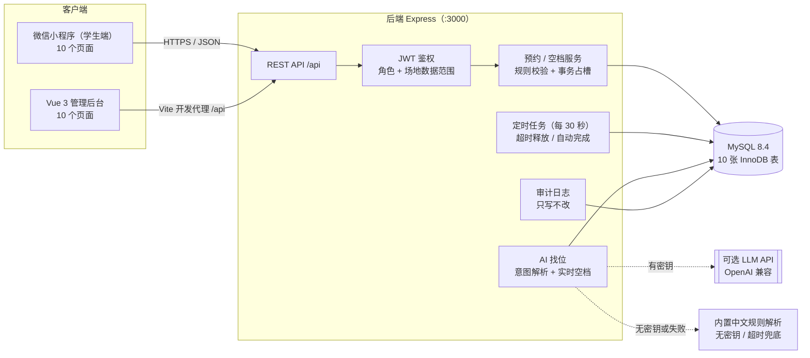
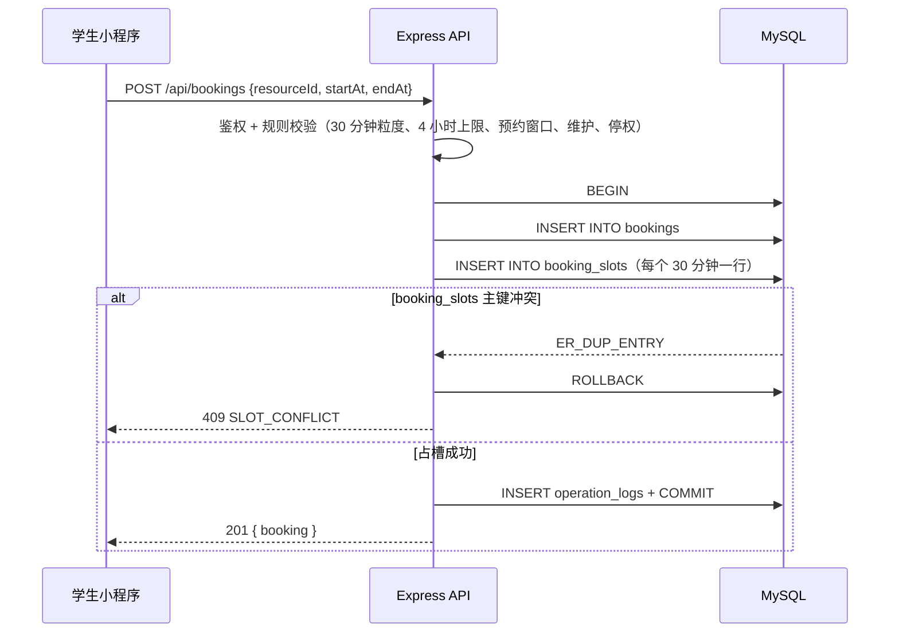

# 智约（zhiyue）· 校园共享空间预约平台

## 1. 项目名称及简介

「智约」是一个面向高校校园的共享空间预约与管理平台，面向研讨室、自习位、琴房、活动室等共享空间，把"查空档---提交预约---到场签到---结束释放---信用结算"串成完整闭环，解决"预约了不来、想用的约不到、出问题难追责"的问题。

> 说明：本仓库对应《专业基础实践》课程项目。当前已完成学生端、管理端、后端 API 与数据库脚本的本地可运行版本，并完成本地联调；`deploy/` 已提供 Docker Compose、Nginx、HTTPS 与云数据库部署配置，根目录 `render.yaml` 和 `docs/免费部署方案.md` 提供无服务器时的 Render + 免费 MySQL + Pages 路径。**公网地址仍需实际开通资源并执行部署后产生**。README 中的运行步骤均以本仓库现有代码为准，未实际执行的部署项不写成已完成。

## 2. 项目主要功能

-   **学生端（微信小程序，10 个页面）**：场地列表与筛选、场地空档查询、预约下单、我的预约、预约详情与二维码、扫码/自助签到、取消预约、相邻时段续约、信用分与申诉、AI 找位助手、个人设置（含 API 地址配置）。
-   **管理端（Vue 3 后台，10 个页面）**：运营仪表盘、场地与维护时段管理、预约管理（筛选、详情、辅助签到、审批）、用户列表、爽约名单、利用率统计、操作日志、申诉处理、规则说明。
-   **AI 找位助手**：把自然语言需求解析为日期、时间、人数、时长和场地类型，再由后端实时查询数据库空档，返回最多 3 个候选结果并说明推荐理由。未配置大模型密钥时自动使用内置中文规则解析，演示环境无需外部服务。
-   **核心业务规则**：30 分钟预约粒度、单笔预约最长 4 小时、允许相邻时段首尾相接、提前 1 天预约、开始后 15 分钟未签到自动释放、近 30 天累计 3 次爽约停权 7 天，以及管理员辅助签到与操作留痕。

## 3. 技术栈

| 层 | 技术选型 |
|---|---|
| 小程序端 | 微信小程序原生（WXML/WXSS/JavaScript） |
| 管理后台 | Vue 3 + Vite 6 + Element Plus + Pinia + Vue Router + Axios |
| 后端 API | Node.js（24.x）+ Express 4 + mysql2 + Zod + JWT |
| 数据库 | MySQL 8.4（InnoDB / utf8mb4） |
| AI 能力 | 可选接入 OpenAI 兼容大模型接口；无密钥时使用内置规则解析 |
| 部署 | Docker Compose + Nginx 配置已就绪；无服务器可用 `render.yaml` 免费方案；公有云 + HTTPS 域名待实际开通后部署 |

> 课程硬性要求中的“公网可访问 URL”仍在准备中，当前版本用于本地开发、联调和微信开发者工具演示。服务器部署见 [docs/部署文档.md](docs/部署文档.md)，无服务器备选见 [docs/免费部署方案.md](docs/免费部署方案.md)，未实际跑通前不视为完成。

### 3.1 系统架构



**预约并发链路（防重复占用的关键路径）：**



核心思路：`bookings` 表只存预约单，`booking_slots` 表按 30 分钟一格记录占用情况，主键 `(resource_id, slot_start)` 是并发不重复的最终保障；任何校验失败或主键冲突都会回滚整个事务。

不支持 Mermaid 的阅读器可参考下面的文本版架构：

```text
微信小程序（学生端） ─┐
                     ├─ HTTP / JSON ─> Express :3000 ─> MySQL 8.4
Vue 3 管理端 ────────┘                   （JWT 鉴权、预约/空档、签到、
                                          AI 找位、定时任务、审计日志）
```

## 4. 项目目录结构

``` text
zhiyue-campus-booking/
├── frontend/
│   ├── mini-program/            # 微信小程序端（原生）
│   │   ├── pages/               # 登录、找场地、空档、预约、签到、信用、AI、我的等 10 页
│   │   ├── utils/               # 请求封装、API 地址配置、格式化工具
│   │   ├── app.js / app.json / app.wxss
│   │   └── project.config.json
│   └── admin/                   # Vue 3 管理后台
│       ├── src/
│       │   ├── views/           # 仪表盘、场地、预约、用户、爽约、统计、日志、申诉、规则
│       │   ├── api/             # Axios 封装
│       │   ├── stores/          # Pinia 登录状态
│       │   └── router/
│       └── vite.config.js       # 开发代理 /api → localhost:3000
├── backend/                     # Express API
│   ├── src/
│   │   ├── routes/              # auth / resources / bookings / credit / ai / admin
│   │   ├── services/            # 预约、空档、信用、调度、AI、审计
│   │   └── middleware/          # JWT 鉴权、参数校验、错误处理
│   ├── scripts/init-db.js       # 建库、建账号、建表、写入演示数据
│   ├── tests/
│   │   ├── core.test.js         # 核心预约、空档、并发、权限（20 项）
│   │   ├── credit.test.js       # 签到、信用、申诉、审批（20 项）
│   │   ├── admin-ops.test.js    # 后台运营、统计、用户、日志（11 项）
│   │   └── uploads.test.js      # 图片上传类型、大小、鉴权（4 项）
│   └── .env.example             # 环境变量模板（不提交真实密钥）
├── database/
│   ├── schema.sql               # 10 张业务表
│   └── seed.sql                 # 演示账号、场地、维护窗口与示例预约
├── scripts/                     # Windows 一键脚本
│   ├── setup.bat                # 下载 MySQL、装依赖、初始化数据库
│   ├── start-all.bat            # 同时启动后端和管理端
│   ├── start-mysql.bat
│   ├── start-backend.bat
│   ├── start-admin.bat
│   └── init-db.bat              # 重置数据库并重新写入演示数据
├── deploy/                      # 公有云部署配置（作业三）
│   ├── docker-compose.yml       # MySQL + 后端 + Nginx 管理端
│   ├── backend.Dockerfile       # 后端生产镜像
│   ├── admin.Dockerfile         # 管理端构建 + Nginx 镜像
│   ├── nginx.conf               # SPA 回退 + /api 反向代理
│   ├── nginx.https.conf.example # HTTPS 完整配置示例
│   └── .env.example             # 生产环境变量模板（全占位符）
├── render.yaml                  # Render 免费部署蓝图（无服务器备选）
├── docs/                        # 项目文档
│   ├── 接口文档.md / .docx      # 全部接口、参数、示例、错误码表
│   ├── 接口契约.md              # 签到、信用、后台运营模块的接口契约
│   ├── 权限矩阵.md              # 三角色接口权限与数据范围
│   ├── 测试用例.md              # 27 条课程用例与 55 项自动化结果
│   ├── AI帮倒忙案例.md          # AI 错误与真实缺陷复盘
│   ├── 数据库设计说明.md / .docx # 表结构、索引、字段取值、并发设计
│   ├── 部署文档.md              # 空服务器到公网访问的完整部署步骤
│   ├── 免费部署方案.md          # 无服务器/无域名：Render + 免费 MySQL + Pages
│   ├── 作业三进度与交接.md      # 当前进度、阻塞、网络实测与下次继续入口
│   ├── 作业三分工与任务清单.md  # 集成发布阶段分工、差距与验收口径
│   ├── ai-log.md / AI使用日志.docx # AI 使用日志（20 条）
│   ├── 开发计划与分工.md
│   ├── 史曼琪任务清单.md
│   ├── 需求说明书.docx
│   ├── 业务规则卡确认单.docx
│   ├── 小组分工与贡献表.docx
│   ├── README.docx              # README 的 Word 提交版
│   ├── 验收截图/                # 管理端与小程序真实验收截图
│   └── 原型设计/                # 高保真原型
├── README.md
├── .dockerignore
└── .gitignore
```

## 5. 安装及运行说明

### 5.1 环境要求

-   Windows 10 / 11（脚本为 Windows 批处理，macOS/Linux 可手动执行对应命令）
-   Node.js 18 或更高版本（本项目使用 24.x 验证）
-   微信开发者工具（运行小程序）
-   Git

> 不需要预先安装 MySQL：`scripts\setup.bat` 会把便携版 MySQL 8.4.9 下载到
> `%USERPROFILE%\zhiyue-tools\mysql`，不会写入系统目录。

### 5.2 Windows 一键启动（推荐）

``` bat
git clone https://github.com/caikenuan/zhiyue-campus-booking.git
cd zhiyue-campus-booking

:: 首次运行：下载 MySQL、安装前后端依赖、建库建表、写入演示数据
scripts\setup.bat

:: 启动后端（3000）和管理端（5173）
scripts\start-all.bat
```

启动后：

-   后端健康检查：<http://localhost:3000/api/health>
-   管理后台：<http://localhost:5173>
-   数据库重置：`scripts\init-db.bat`（会删除并重建全部业务表，仅用于本地演示）

### 5.3 手动启动（macOS / Linux 或已安装 MySQL）

``` bash
# 1. 安装依赖
cd backend && npm install
cd ../frontend/admin && npm install

# 2. 配置数据库（默认 root 空密码；如有密码复制 .env.example 为 .env 后修改）
cd ../../backend
npm run db:init

# 3. 启动后端（新终端）
npm start

# 4. 启动管理端（新终端）
cd ../frontend/admin
npm run dev
```

### 5.4 小程序端运行

1.  打开微信开发者工具，选择“导入项目”。
2.  目录选择仓库中的 `frontend/mini-program`。
3.  项目已配置课程演示用的测试号 AppID；如果工具提示 AppID 无效，在导入时选择自己的“测试号”，并把新 AppID 填到本地 `project.private.config.json`（该文件已被 Git 忽略，不要提交）。
4.  进入“详情 → 本地设置”，勾选**不校验合法域名、web-view（业务域名）、TLS 版本以及 HTTPS 证书**。
5.  确认后端已启动，然后点击“编译”。
6.  使用学生账号登录（见 5.5）。

> 真机预览：把 `我的 → 服务地址` 改成电脑的局域网 IP，例如
> `http://192.168.1.10:3000/api`，手机与电脑需在同一 Wi-Fi，并允许 Windows
> 防火墙放行 3000 端口。默认地址为 `http://localhost:3000/api`。

### 5.5 演示账号

| 角色 | 账号 | 密码 | 说明 |
|---|---|---|---|
| 学院管理员 | `admin` | `admin123` | 可查看全部场地、预约和日志 |
| 场地管理员 | `manager` | `manager123` | 只能管理分配给自己的场地 |
| 学生 | `2024030202003` | `123456` | 蔡珂暖 |
| 学生 | `2024030202107` | `123456` | 史曼琪 |
| 学生 | `2024000001` | `123456` | 测试学生（信用分 90） |

> 以上账号仅用于本地课程演示，密码为演示口令，不包含任何真实个人信息。

### 5.6 本地验证记录

-   后端启动成功，`/api/health` 返回 `{"ok":true}`。
-   管理员、场地管理员、学生三类账号登录成功，角色权限按预期生效。
-   场地列表、明天空档查询、创建预约、取消预约、信用查询、AI 找位接口均返回正常。
-   同一场地同一时段发起 **10 个并发预约**，结果为 **1 个成功、9 个返回 `SLOT_CONFLICT`**，满足课程并发验收要求。
-   后端自动化测试 `cd backend && npm test` 共 **55 项全部通过**（核心 20 项 + 签到/信用/申诉 20 项 + 后台运营 11 项 + 图片上传 4 项），覆盖登录权限、30 分钟粒度、4 小时上限、跨天、预约窗口、重复预约、取消释放、并发、AI 解析、签到窗口、爽约停权、申诉、审批、统计、日志和图片上传校验。
-   管理端 `npm run build` 构建通过，开发服务器页面可访问。
-   小程序端已在微信开发者工具中编译通过：登录页、找场地首页（6 个场地）、AI 找位、我的预约、信用分、场地空档页均可正常打开，列表与空档数据来自本地后端接口。
-   2026-11-22 史曼琪完成签到、信用与后台运营模块验收：27 条课程用例记录、51 项自动化测试、11 张管理端截图和 4 张小程序截图已归档到 `docs/测试用例.md` 与 `docs/验收截图/`。
-   2026-11-25 合并 `feat/s2-shimanqi` 后复跑 `cd backend && npm test`，**51 项仍全部通过**；管理端 `npm run build` 复跑通过；同日补充接口文档、数据库设计说明和 AI 使用日志，并复跑 10 并发场景（1 成功 / 9 个 `SLOT_CONFLICT`）。

### 5.7 环境变量清单

后端读取 `backend/.env`（由 `.env.example` 复制而来）；`.env` 已被 Git 忽略。所有变量均有本地默认值，不配置也能在默认环境下启动，但**部署或共享前必须替换 `JWT_SECRET` 和数据库口令**。

| 变量 | 必填 | 默认值 | 说明 |
|---|---|---|---|
| `PORT` | 否 | `3000` | 后端监听端口，修改后需同步管理端代理和小程序 API 地址 |
| `JWT_SECRET` | 部署必填 | `zhiyue-local-dev-secret-change-before-sharing` | JWT 签名密钥；生产环境使用长度 ≥ 32 的随机字符串 |
| `DB_HOST` | 否 | `127.0.0.1` | MySQL 地址 |
| `DB_PORT` | 否 | `3306` | MySQL 端口 |
| `DB_NAME` | 否 | `zhiyue` | 业务数据库名，初始化脚本会自动创建 |
| `DB_USER` | 否 | `zhiyue` | 业务数据库账号，初始化脚本会自动创建并授权 |
| `DB_PASSWORD` | 否 | `zhiyue_dev` | 业务数据库密码 |
| `DB_ROOT_USER` | 否 | `root` | 初始化数据库时使用的管理员账号（仅建库/建账号需要） |
| `DB_ROOT_PASSWORD` | 否 | 空 | 本机 root 密码；便携版 MySQL 默认空密码 |
| `LLM_BASE_URL` | 否 | 空 | OpenAI 兼容接口地址，例如 `https://api.example.com/v1`；三项都填写才启用大模型 |
| `LLM_API_KEY` | 否 | 空 | 大模型 API Key，只放本地 `.env`，不提交 |
| `LLM_MODEL` | 否 | 空 | 模型名，例如组织内可用的聊天模型名称 |

补充说明：

-   JWT 有效期当前固定为 7 天，写在 `backend/src/config.js` 的 `jwtExpiresIn`，不从环境变量读取。
-   小程序端没有 `.env` 文件，API 地址保存在本机 storage 中，默认 `http://localhost:3000/api`，可在「我的 → 服务地址」修改；真机调试时改成电脑局域网 IP。
-   管理端开发服务器通过 `frontend/admin/vite.config.js` 把 `/api` 代理到 `http://localhost:3000`，不依赖环境变量。
-   数据库连接在 `backend/src/db.js` 中固定 `timezone: '+08:00'`、`dateStrings: true`，所有接口时间均按北京时间字符串返回。

### 5.8 常见错误排查

| 现象 | 常见原因 | 处理办法 |
|---|---|---|
| `/api/health` 返回 503 或日志提示 `ECONNREFUSED` | MySQL 未启动，或端口不是 3306 | 运行 `scripts\start-mysql.bat`；检查 `backend/.env` 的 `DB_HOST/DB_PORT`；确认没有其他 MySQL 占用 3306 |
| `npm run db:init` 报 `ER_ACCESS_DENIED_ERROR` | `DB_ROOT_USER/DB_ROOT_PASSWORD` 不正确 | 修改 `backend/.env`；便携版 MySQL 默认 `root` 空密码；若改用系统 MySQL，填写真实 root 口令 |
| 建库后中文显示为乱码 | 数据库/连接字符集不是 `utf8mb4` | 确认 `schema.sql`、`seed.sql` 顶部的 `SET NAMES utf8mb4` 已执行；重新运行 `scripts\init-db.bat`；连接统一使用 `utf8mb4` |
| 3000 端口被占用 | 已有一个后端进程在运行，或端口冲突 | 先访问 `http://localhost:3000/api/health` 确认是否为本项目；不要直接杀进程，必要时修改 `PORT` 并同步 `vite.config.js` 代理 |
| 5173 端口被占用 | Vite 已启动或端口冲突 | 关闭重复终端；Vite 会自动尝试下一个端口，以终端输出为准，并相应修改访问地址 |
| 管理端页面空白或接口 404 | 后端未启动，或代理目标不对 | 确认后端先启动；检查 `vite.config.js` 中代理目标；重新执行 `npm run dev` |
| 小程序请求报“不在以下 request 合法域名列表中” | 开发者工具未关闭域名校验 | 详情 → 本地设置 → 勾选“不校验合法域名、web-view、TLS 版本以及 HTTPS 证书” |
| 小程序导入提示 AppID 无效 | 课程演示 AppID 不可用 | 导入时选择自己的测试号，把新 AppID 填入已被忽略的 `project.private.config.json`，不要提交 |
| 小程序登录成功但列表为空 | API 地址指向错误，或数据库未初始化 | 检查「我的 → 服务地址」；用浏览器访问 `/api/health`；执行 `scripts\init-db.bat` |
| 接口返回 401 `UNAUTHORIZED` | 未登录或 JWT 过期（7 天） | 重新登录；确认请求头为 `Authorization: Bearer <token>` |
| 接口返回 403 `USER_SUSPENDED` | 近 30 天累计 3 次爽约，账号停权 7 天 | 在信用页查看停权截止时间；演示时可重置数据库或处理申诉 |
| 预约返回 409 `SLOT_CONFLICT` | 该时段已被其他预约占用（含并发抢单） | 刷新空档后选择其他时段；这是并发防超卖的正常结果 |
| 预约返回 400 `BOOKING_WINDOW_INVALID` | 时间不在今天/明天、已过开始时间、超出场地开放时间 | 按规则选择今天或明天的开放时段，且开始时间不能早于当前时间 |
| 签到返回 409 `CHECKIN_EXPIRED` | 已超过开始后 15 分钟 | 正常签到窗口已关闭；若确有异常，走申诉流程，不能补记正常签到 |
| 定时任务没有自动释放预约 | 后端未运行，或系统时间/时区不一致 | 确认后端进程存在；可调用 `POST /api/admin/scheduler/run`（学院管理员）手动触发；统一使用北京时间 |
| 真机无法访问后端 | 手机不能访问 `localhost`，或防火墙拦截 | 把小程序服务地址改为电脑局域网 IP，例如 `http://192.168.1.10:3000/api`；Windows 防火墙放行 3000 端口；手机与电脑同一 Wi-Fi |
| 首次安装依赖很慢或失败 | npm 网络问题 | 切换可用的 npm 镜像后重试；确认 Node.js ≥ 18（推荐 24.x） |

### 5.9 公有云部署（作业三）

仓库提供 `deploy/` 部署配置，完整步骤见 [docs/部署文档.md](docs/部署文档.md)：域名备案与 HTTPS、Docker Compose、云数据库白名单与备份、Nginx 子路由回退、对象存储接入和小程序体验版发布。若暂未采购云服务器，按 [docs/免费部署方案.md](docs/免费部署方案.md) 使用 Render + 免费 MySQL + Cloudflare Pages 先跑通公网后台；平台子域名不能替代备案域名，小程序体验版仍需正式 AppID。

```bash
cd deploy
cp .env.example .env    # 填写随机密码与 JWT_SECRET
docker compose up -d --build
curl http://127.0.0.1/api/health
```

> `deploy/` 中的配置只代表“部署方案已准备”，线上地址必须等云服务器实际执行成功后才能写进上线记录单。

## 6. Git 分支约定

| 分支 | 用途 |
|---|---|
| `main` | 稳定主分支，仅合入已检查的内容 |
| `feat/s2-booking-core` | 预约规则、时段模型与并发占槽 |
| `feat/s2-ai-assistant` | AI 找位助手 |
| `feat/s2-checkin-credit` | 签到、自动释放、信用与申诉 |
| `feat/s2-admin-ops` | 审批、用户、爽约名单、统计与日志 |

约定：

1.  新任务从 `main` 创建对应功能分支，分支名称以 `feat/` 开头。
2.  两位成员分别负责若干完整功能模块，每个模块均包含对应的前端页面、后端接口和测试，不采用一人只做前端、另一人只做后端的分工方式。
3.  完成后先进行代码检查和前后端联调，再通过 Pull
    Request（合并请求）合并到 `main`。
4.  不要将密码、访问令牌、数据库真实账号等敏感信息提交到仓库。

## 7. 小组成员与分工

本项目由两名成员共同完成，采用**按功能模块划分、前后端同步负责**的方式。两位成员均参与前端页面、后端接口、测试与文档工作，整体任务量尽量保持均衡。组长主要负责进度协调和协作组织，不代表承担更多开发任务。

| 成员 | 角色 | 主要负责模块 | 前端职责 | 后端职责 |
|---|---|---|---|---|
| 蔡珂暖（2024030202003） | 组长 | 学生预约与个人服务、场地基础信息 | 学生端空档查询、预约下单、我的预约、取消与申诉等页面；管理端场地信息展示相关页面 | 场地信息查询、空闲时段查询、预约创建与取消、个人预约记录查询等接口 |
| 史曼琪（2024030202107） | 组员 | 签到与信用管理、后台运营管理 | 学生端扫码签到、信用分等页面；管理端预约审批、用户与角色、爽约名单、统计及操作日志等页面 | 签到与预约状态流转、未签到自动释放、爽约与停权、管理员辅助签到、用户角色及运营管理相关接口 |

### 共同完成的工作

1.  **数据库设计**：共同设计并确认用户、场地、时段、预约、签到、信用记录和操作日志等数据表结构。
2.  **接口规范**：共同确定接口地址、请求参数、响应格式、权限校验和错误处理规则。
3.  **前后端联调**：分别完成负责模块后，互相检查接口和页面，解决数据字段、状态和权限不一致的问题。
4.  **测试验收**：共同完成正常、边界、并发、权限和状态流转测试；每人既要测试自己负责的模块，也要参与对方模块的交叉测试。
5.  **部署与文档**：共同完成项目运行配置、部署验证、使用说明和最终材料整理。
6.  **任务量平衡**：按模块实际复杂度分配工作；若某一方任务明显偏多，双方协商调整页面、接口或测试任务，确保最终工作量与贡献尽量接近。

> 以上为当前阶段的计划分工。实际开发中可根据进度协商调整；每位成员都应保留前端和后端的实际提交记录。每周计划投入时间、Git
> 提交次数、代码行数和互评等内容，应根据实际情况填写，不提前虚构。

## 8. GitHub 仓库地址

项目主页：<https://github.com/caikenuan/zhiyue-campus-booking>

仓库克隆地址：

``` bash
git clone https://github.com/caikenuan/zhiyue-campus-booking.git
```

## 9. 项目文档索引

| 文档 | 内容 |
|---|---|
| [README.md](README.md) / [docs/README.docx](docs/README.docx) | 架构图、目录说明、启动步骤、环境变量、错误排查 |
| [docs/接口文档.md](docs/接口文档.md) / [docs/接口文档.docx](docs/接口文档.docx) | 预约、查询、签到、取消、统计等全部接口的参数、示例、错误码与权限矩阵 |
| [docs/数据库设计说明.md](docs/数据库设计说明.md) / [docs/数据库设计说明.docx](docs/数据库设计说明.docx) | 10 张表的结构、索引、字段取值、并发与状态机设计 |
| [docs/ai-log.md](docs/ai-log.md) / [docs/AI使用日志.docx](docs/AI使用日志.docx) | 20 条 AI 使用日志：任务、提示词要点、采纳/驳回、发现的问题 |
| [docs/接口契约.md](docs/接口契约.md) | 签到、信用、后台运营模块的接口契约与错误码 |
| [docs/权限矩阵.md](docs/权限矩阵.md) | 三角色接口权限、数据范围与前端菜单 |
| [docs/测试用例.md](docs/测试用例.md) | 27 条课程验收用例、55 项自动化结果、执行记录与截图索引 |
| [docs/AI帮倒忙案例.md](docs/AI帮倒忙案例.md) | AI 错误命令与真实业务缺陷的复盘、前后对比与验证 |
| [docs/验收截图/](docs/验收截图/) | 管理端 11 张、小程序 4 张真实验收截图 |
| [docs/需求说明书.docx](docs/需求说明书.docx) | 按当前实现修订的需求说明书 v2.0：角色、规则、10+10 页面、约束、27 条验收场景 |
| [docs/业务规则卡确认单.docx](docs/业务规则卡确认单.docx) | 六项参数、补充规则、实现核对与证据位置 |
| [docs/小组分工与贡献表.docx](docs/小组分工与贡献表.docx) | 分工、作业二交付物、Git 贡献过程快照与互评占位 |
| [docs/开发计划与分工.md](docs/开发计划与分工.md) | 规则基线、开发计划、任务分工、风险与测试计划 |
| [docs/史曼琪任务清单.md](docs/史曼琪任务清单.md) | 组员模块验收、补测试与文档的执行清单 |
| [docs/部署文档.md](docs/部署文档.md) | 作业三：空服务器、Docker、HTTPS、云数据库、对象存储与小程序发布 |
| [docs/免费部署方案.md](docs/免费部署方案.md) | 无服务器/无域名时：Render + Aiven 免费 MySQL + Cloudflare Pages + B2，含限制与记录单口径 |
| [docs/作业三分工与任务清单.md](docs/作业三分工与任务清单.md) | 作业三现状差距、两人分工、时间安排与上线记录单证据对照 |
| [docs/作业三进度与交接.md](docs/作业三进度与交接.md) | 当前进度、未完成项、网络实测、朋友服务器评估与下次继续步骤 |

> Word 交付版统一放在 `docs/`，Markdown 源文件用于 GitHub 在线阅读和后续维护；仓库根目录只保留 `README.md` 和代码，避免重复文件。

## 10. 已知限制与后续计划

-   **公网部署尚未完成**：`deploy/` 的 Docker Compose、Nginx、HTTPS 与备份方案已写好，但还没有云服务器和备案域名，线上地址尚不存在；对象存储（场地图片、签到照片）的上传接口也尚未实现，这两项不能提前勾选完成。
-   **AI 大模型为可选配置**：未填写 `LLM_BASE_URL / LLM_API_KEY / LLM_MODEL` 时使用内置规则解析，不影响演示；接入真实模型后可提升口语化理解能力。
-   **自动化测试与验收材料**：已完成核心接口联调和 10 并发预约验证，当前 55 项后端自动化测试全部通过（含 4 项图片上传）；27 条课程用例、验收截图与缺陷记录已归档到 `docs/测试用例.md`，演示录屏仍在准备。
-   **真机演示需配置网络**：手机不能直接访问 `localhost`，需按 5.4 节改为电脑局域网 IP。
