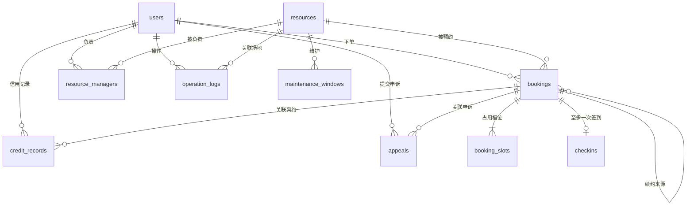

# 智约 · 数据库设计说明

> 数据库：MySQL 8.4（兼容 8.0+），存储引擎 InnoDB，字符集 `utf8mb4` / `utf8mb4_unicode_ci`。
> 建表脚本：[database/schema.sql](../database/schema.sql)；演示数据：[database/seed.sql](../database/seed.sql)。
> 初始化方式：`cd backend && npm run db:init`（会 DROP 并重建全部业务表，仅用于本地演示）。
> 最后核对：2026-11-25。

## 1. 设计目标

1. **预约不重复**：同一场地同一 30 分钟槽位最多被一笔有效预约占用，并发下也必须成立。
2. **状态可追溯**：预约从创建、签到、完成、取消、释放到申诉，每次变化都有记录。
3. **权限有边界**：场地管理员只能管理分配给自己的场地，数据范围在表结构中可查询。
4. **审计不可篡改**：关键操作写入 `operation_logs`，接口层不提供修改/删除。
5. **规则可解释**：30 分钟粒度、4 小时上限、15 分钟签到窗口、3 次爽约停权等规则都能落到具体字段和查询上。

## 2. 实体关系



## 3. 表结构

### 3.1 `users` 用户

| 字段 | 类型 | 允许空 | 默认值 | 说明 |
|---|---|---|---|---|
| `id` | BIGINT UNSIGNED | 否 | AUTO_INCREMENT | 主键 |
| `student_no` | VARCHAR(32) | 否 | — | 学号；管理员用 `admin` / `manager` 作为登录账号 |
| `name` | VARCHAR(64) | 否 | — | 姓名 |
| `password_hash` | VARCHAR(255) | 否 | — | `scrypt` 哈希，格式 `salt:hash`，不存明文 |
| `role` | ENUM | 否 | `STUDENT` | `STUDENT` / `VENUE_ADMIN` / `COLLEGE_ADMIN` |
| `status` | ENUM | 否 | `ACTIVE` | `ACTIVE` 启用 / `DISABLED` 停用 |
| `credit_score` | INT | 否 | 100 | 信用分，0—100；爽约 -10，申诉通过 +10 |
| `suspended_until` | DATETIME | 是 | NULL | 停权截止时间；NULL 表示未停权 |
| `created_at` | DATETIME | 否 | CURRENT_TIMESTAMP | 创建时间 |

索引：

| 索引 | 类型 | 用途 |
|---|---|---|
| `PRIMARY KEY (id)` | 主键 | 按 ID 查用户 |
| `UNIQUE KEY uk_users_student_no (student_no)` | 唯一 | 登录查询、防止重复学号 |
| `KEY idx_users_role (role)` | 普通 | 管理端按角色筛选用户 |

关键取值：

-   `role = 'VENUE_ADMIN'` 只代表“场地管理员身份”，具体负责哪些场地由 `resource_managers` 决定；未绑定任何场地的场地管理员看不到数据。
-   `status = 'DISABLED'` 时登录和鉴权都会被拒绝（403）。
-   `suspended_until > NOW()` 期间可以登录、查看，但创建预约会返回 `USER_SUSPENDED`。

### 3.2 `resources` 场地

| 字段 | 类型 | 允许空 | 默认值 | 说明 |
|---|---|---|---|---|
| `id` | BIGINT UNSIGNED | 否 | AUTO_INCREMENT | 主键 |
| `name` | VARCHAR(100) | 否 | — | 场地名称 |
| `type` | ENUM | 否 | — | `SEMINAR` 研讨室 / `STUDY` 自习区 / `PIANO` 琴房 / `ACTIVITY` 活动室 / `SPORTS` 运动场地 |
| `building` | VARCHAR(100) | 否 | — | 楼栋 |
| `room` | VARCHAR(50) | 否 | — | 房间号 |
| `capacity` | INT | 否 | 1 | 可容纳人数 |
| `open_from` | TIME | 否 | `08:00:00` | 每日开放开始时间 |
| `open_to` | TIME | 否 | `22:00:00` | 每日开放结束时间 |
| `status` | ENUM | 否 | `OPEN` | `OPEN` 开放 / `CLOSED` 未开放 |
| `description` | VARCHAR(255) | 是 | NULL | 描述 |
| `created_at` | DATETIME | 否 | CURRENT_TIMESTAMP | 创建时间 |

索引：

| 索引 | 类型 | 用途 |
|---|---|---|
| `PRIMARY KEY (id)` | 主键 | 详情、空档查询 |
| `KEY idx_resources_type (type)` | 普通 | 小程序按类型筛选 |
| `KEY idx_resources_status (status)` | 普通 | 只查开放场地 |

关键取值：

-   空档按 `open_from`—`open_to` 以 30 分钟切分；开放时间由管理员维护，必须满足 `open_to > open_from`。
-   `status = 'CLOSED'` 时不出现在学生端列表，也不能创建新预约。
-   删除场地前会检查是否存在预约记录；有记录时禁止删除，建议改为 `CLOSED`。

### 3.3 `resource_managers` 场地负责管理员

| 字段 | 类型 | 允许空 | 默认值 | 说明 |
|---|---|---|---|---|
| `resource_id` | BIGINT UNSIGNED | 否 | — | 场地 ID |
| `user_id` | BIGINT UNSIGNED | 否 | — | 管理员用户 ID |
| `created_at` | DATETIME | 否 | CURRENT_TIMESTAMP | 绑定时间 |

索引与约束：

| 约束 | 说明 |
|---|---|
| `PRIMARY KEY (resource_id, user_id)` | 同一场地与同一管理员只绑定一次（`INSERT IGNORE` 幂等） |
| `KEY idx_resource_managers_user (user_id)` | 按管理员反查负责场地，权限校验高频使用 |
| `fk_resource_managers_resource` | `ON DELETE CASCADE`：删除场地自动清理绑定 |
| `fk_resource_managers_user` | `ON DELETE CASCADE`：删除用户自动清理绑定 |

> 这张表是场地管理员数据范围的唯一来源。鉴权顺序：先确认角色，再用 `user_id` 查出 `resource_id` 列表，最后在查询或写入时加 `resource_id IN (...)`。

### 3.4 `maintenance_windows` 维护窗口

| 字段 | 类型 | 允许空 | 默认值 | 说明 |
|---|---|---|---|---|
| `id` | BIGINT UNSIGNED | 否 | AUTO_INCREMENT | 主键 |
| `resource_id` | BIGINT UNSIGNED | 否 | — | 场地 ID |
| `start_at` | DATETIME | 否 | — | 维护开始 |
| `end_at` | DATETIME | 否 | — | 维护结束 |
| `reason` | VARCHAR(255) | 是 | NULL | 维护原因 |
| `created_by` | BIGINT UNSIGNED | 是 | NULL | 创建人 |
| `created_at` | DATETIME | 否 | CURRENT_TIMESTAMP | 创建时间 |

索引与约束：

| 约束 | 说明 |
|---|---|
| `PRIMARY KEY (id)` | 主键 |
| `KEY idx_maintenance_resource_time (resource_id, start_at, end_at)` | 按场地和时间范围查维护窗口（空档查询、预约冲突校验） |
| `fk_maintenance_resource` | `ON DELETE CASCADE` |
| `fk_maintenance_creator` | `ON DELETE SET NULL`，保留维护记录 |

关键取值：时间区间按半开区间处理，与预约冲突判断一致：`start_at < booking_end AND end_at > booking_start`。

### 3.5 `bookings` 预约单

| 字段 | 类型 | 允许空 | 默认值 | 说明 |
|---|---|---|---|---|
| `id` | BIGINT UNSIGNED | 否 | AUTO_INCREMENT | 主键 |
| `user_id` | BIGINT UNSIGNED | 否 | — | 下单学生 |
| `resource_id` | BIGINT UNSIGNED | 否 | — | 场地 |
| `start_at` | DATETIME | 否 | — | 开始时间，30 分钟网格 |
| `end_at` | DATETIME | 否 | — | 结束时间，与开始同一天 |
| `status` | ENUM | 否 | `PENDING` | 见 4.1 |
| `source` | ENUM | 否 | `MINI_PROGRAM` | `MINI_PROGRAM` / `ADMIN` |
| `qr_token` | VARCHAR(64) | 否 | — | 32 位十六进制随机签到码，不可用 ID 代替 |
| `checked_in_at` | DATETIME | 是 | NULL | 实际签到时间 |
| `cancelled_at` | DATETIME | 是 | NULL | 取消/驳回时间 |
| `cancel_reason` | VARCHAR(255) | 是 | NULL | 取消/驳回原因 |
| `renewed_from_id` | BIGINT UNSIGNED | 是 | NULL | 续约来源预约 ID |
| `created_at` | DATETIME | 否 | CURRENT_TIMESTAMP | 创建时间 |
| `updated_at` | DATETIME | 否 | CURRENT_TIMESTAMP ON UPDATE | 更新时间 |

索引：

| 索引 | 类型 | 用途 |
|---|---|---|
| `PRIMARY KEY (id)` | 主键 | 详情 |
| `UNIQUE KEY uk_bookings_qr_token (qr_token)` | 唯一 | 扫码签到；防止签到码重复 |
| `KEY idx_bookings_user_time (user_id, start_at)` | 普通 | “我的预约”按时间排序 |
| `KEY idx_bookings_resource_time (resource_id, start_at, end_at)` | 普通 | 管理端按场地/时间筛选 |
| `KEY idx_bookings_status_time (status, start_at)` | 普通 | 定时任务扫描待签到/已签到预约 |

关键取值：

-   `status = 'PENDING'` 且 `start_at + 15 分钟 <= NOW()` 是自动释放的候选。
-   `status = 'CHECKED_IN'` 且 `end_at <= NOW()` 是自动完成的候选。
-   取消、释放、驳回、完成都会删除对应 `booking_slots` 行，但保留 `bookings` 行用于历史追溯。
-   为什么不直接在 `bookings` 上建 `(resource_id, start_at)` 唯一键：唯一键只能锁住“开始时间”，`08:00-09:00` 与 `08:30-09:30` 的开始时间不同，仍可能重叠。占用粒度必须以 30 分钟槽位为准，见 `booking_slots`。

### 3.6 `booking_slots` 预约槽位（并发核心）

| 字段 | 类型 | 允许空 | 默认值 | 说明 |
|---|---|---|---|---|
| `resource_id` | BIGINT UNSIGNED | 否 | — | 场地 |
| `slot_start` | DATETIME | 否 | — | 槽位开始时刻，必须是 30 分钟网格 |
| `booking_id` | BIGINT UNSIGNED | 否 | — | 所属预约 |

索引与约束：

| 约束 | 说明 |
|---|---|
| `PRIMARY KEY (resource_id, slot_start)` | **核心唯一约束**：同一场地同一槽位只能有一行，并发重复插入必然冲突 |
| `KEY idx_booking_slots_booking (booking_id)` | 取消/释放时按预约删除占用 |
| `fk_booking_slots_resource` | `ON DELETE RESTRICT`，防止误删有占用的场地 |
| `fk_booking_slots_booking` | `ON DELETE CASCADE`，预约删除时自动清理槽位 |

写入方式：创建预约时，对 `[start_at, end_at)` 内每个 30 分钟时刻插入一行。例如 `20:00-21:00` 写 `20:00`、`20:30` 两行。

并发语义：10 个请求同时预约同一场地同一时段，最多 1 个事务能把全部槽位插入并提交；其余事务在插入重复主键时得到 `ER_DUP_ENTRY`，整体回滚并返回 `409 SLOT_CONFLICT`。该方案不依赖应用层先查后写，避免了“查的时候空、写的时候已被占”的竞态。

### 3.7 `checkins` 签到记录

| 字段 | 类型 | 允许空 | 默认值 | 说明 |
|---|---|---|---|---|
| `id` | BIGINT UNSIGNED | 否 | AUTO_INCREMENT | 主键 |
| `booking_id` | BIGINT UNSIGNED | 否 | — | 预约 |
| `method` | ENUM | 否 | — | `QR` 自助扫码 / `ASSISTED` 管理员辅助 |
| `operator_id` | BIGINT UNSIGNED | 是 | NULL | 辅助签到时记录管理员；学生自助签到时为 NULL |
| `checked_in_at` | DATETIME | 否 | — | 签到时间 |

索引与约束：

| 约束 | 说明 |
|---|---|
| `PRIMARY KEY (id)` | 主键 |
| `UNIQUE KEY uk_checkins_booking (booking_id)` | 一笔预约最多一条签到记录，数据库层防止重复签到 |
| `KEY idx_checkins_operator (operator_id)` | 查询某管理员的辅助签到记录 |
| `fk_checkins_booking` | `ON DELETE CASCADE` |
| `fk_checkins_operator` | `ON DELETE SET NULL` |

### 3.8 `credit_records` 信用记录

| 字段 | 类型 | 允许空 | 默认值 | 说明 |
|---|---|---|---|---|
| `id` | BIGINT UNSIGNED | 否 | AUTO_INCREMENT | 主键 |
| `user_id` | BIGINT UNSIGNED | 否 | — | 用户 |
| `booking_id` | BIGINT UNSIGNED | 是 | NULL | 关联预约；演示数据中可有手工记录 |
| `type` | ENUM | 否 | — | `NO_SHOW` 爽约 / `APPEAL_REVOKE` 申诉撤销 / `MANUAL` 手工调整 |
| `status` | ENUM | 否 | `VALID` | `VALID` 有效 / `REVOKED` 已撤销 |
| `occurred_at` | DATETIME | 否 | — | 发生时间，用于 30 天窗口统计 |
| `note` | VARCHAR(255) | 是 | NULL | 说明 |
| `created_at` | DATETIME | 否 | CURRENT_TIMESTAMP | 创建时间 |

索引：

| 索引 | 类型 | 用途 |
|---|---|---|
| `PRIMARY KEY (id)` | 主键 | 主键 |
| `KEY idx_credit_user_time (user_id, occurred_at)` | 普通 | 近 30 天有效爽约计数、信用记录列表 |
| `KEY idx_credit_status (status)` | 普通 | 爽约名单只统计 `VALID` |

关键取值：

-   爽约计数只统计 `type = 'NO_SHOW' AND status = 'VALID' AND occurred_at >= 30 天前`。
-   申诉通过后把对应记录改为 `REVOKED`，信用分 +10（上限 100）；若剩余有效爽约不足 3 次，清空 `users.suspended_until`。
-   记录不物理删除，撤销通过 `status` 表达。

### 3.9 `appeals` 申诉

| 字段 | 类型 | 允许空 | 默认值 | 说明 |
|---|---|---|---|---|
| `id` | BIGINT UNSIGNED | 否 | AUTO_INCREMENT | 主键 |
| `booking_id` | BIGINT UNSIGNED | 否 | — | 被释放的预约 |
| `user_id` | BIGINT UNSIGNED | 否 | — | 申诉学生 |
| `reason` | TEXT | 否 | — | 申诉理由（接口限制 5—1000 字） |
| `status` | ENUM | 否 | `PENDING` | `PENDING` / `APPROVED` / `REJECTED` |
| `handled_by` | BIGINT UNSIGNED | 是 | NULL | 处理人 |
| `handled_at` | DATETIME | 是 | NULL | 处理时间 |
| `result` | VARCHAR(255) | 是 | NULL | 处理结果说明 |
| `created_at` | DATETIME | 否 | CURRENT_TIMESTAMP | 提交时间 |

索引与约束：

| 约束 | 说明 |
|---|---|
| `PRIMARY KEY (id)` | 主键 |
| `KEY idx_appeals_status (status)` | 管理端筛待处理申诉 |
| `KEY idx_appeals_user (user_id)` | 学生查看自己的申诉 |
| `fk_appeals_booking` | `ON DELETE CASCADE` |
| `fk_appeals_user` | `ON DELETE CASCADE` |
| `fk_appeals_handler` | `ON DELETE SET NULL` |

关键取值：只有 `bookings.status = 'RELEASED'` 的预约可以申诉；同一预约同时最多一条 `PENDING` 申诉（应用层校验）。

### 3.10 `operation_logs` 操作日志

| 字段 | 类型 | 允许空 | 默认值 | 说明 |
|---|---|---|---|---|
| `id` | BIGINT UNSIGNED | 否 | AUTO_INCREMENT | 主键 |
| `actor_id` | BIGINT UNSIGNED | 是 | NULL | 操作人；系统任务为 NULL |
| `action` | VARCHAR(64) | 否 | — | 动作码，见 4.4 |
| `target_type` | VARCHAR(32) | 否 | — | `booking` / `resource` / `user` / `appeal` / `credit_record` / `maintenance` |
| `target_id` | BIGINT UNSIGNED | 是 | NULL | 目标 ID |
| `resource_id` | BIGINT UNSIGNED | 是 | NULL | 关联场地，便于场地管理员按范围查日志 |
| `detail` | JSON | 是 | NULL | 结构化详情（原因、参数、结果等） |
| `created_at` | DATETIME | 否 | CURRENT_TIMESTAMP | 记录时间 |

索引与约束：

| 约束 | 说明 |
|---|---|
| `PRIMARY KEY (id)` | 主键 |
| `KEY idx_logs_actor_time (actor_id, created_at)` | 按操作人查日志 |
| `KEY idx_logs_target (target_type, target_id)` | 追溯某个预约/场地/用户 |
| `KEY idx_logs_resource (resource_id, created_at)` | 场地管理员按负责场地查日志 |
| `fk_logs_actor` | `ON DELETE SET NULL`，删除用户不删除审计记录 |

设计原则：**只写不改**。接口层没有 UPDATE/DELETE 日志的入口；`detail` 用 JSON 保留上下文，避免频繁加列。

## 4. 取值字典

### 4.1 预约状态 `bookings.status`

```text
PENDING ──签到──> CHECKED_IN ──结束──> COMPLETED
   │
   ├──用户取消──> CANCELLED
   └──超时未签到──> RELEASED（计一次爽约）

PENDING_APPROVAL ──管理员通过──> PENDING
                 └──管理员驳回──> REJECTED
```

| 值 | 是否占用 `booking_slots` | 说明 |
|---|---|---|
| `PENDING` | 是 | 待签到 |
| `CHECKED_IN` | 是（到期完成后删除） | 已签到 |
| `COMPLETED` | 否 | 已结束 |
| `CANCELLED` | 否 | 已取消 |
| `RELEASED` | 否 | 超时未签到，系统释放 |
| `PENDING_APPROVAL` | 是 | 待审批，仍占位 |
| `REJECTED` | 否 | 审批驳回 |

### 4.2 用户与场地

| 字段 | 取值 | 说明 |
|---|---|---|
| `users.role` | `STUDENT` | 学生 |
| | `VENUE_ADMIN` | 场地管理员 |
| | `COLLEGE_ADMIN` | 学院管理员 |
| `users.status` | `ACTIVE` / `DISABLED` | 启用 / 停用 |
| `resources.type` | `SEMINAR` / `STUDY` / `PIANO` / `ACTIVITY` / `SPORTS` | 场地类型 |
| `resources.status` | `OPEN` / `CLOSED` | 开放 / 未开放 |

### 4.3 签到、信用、申诉

| 字段 | 取值 | 说明 |
|---|---|---|
| `checkins.method` | `QR` | 学生扫签到码或点击自助签到 |
| | `ASSISTED` | 管理员在后台辅助签到，记录 `operator_id` |
| `credit_records.type` | `NO_SHOW` | 超时未签到 |
| | `APPEAL_REVOKE` | 申诉通过后的撤销记录（预留） |
| | `MANUAL` | 管理员手工调整（预留） |
| `credit_records.status` | `VALID` / `REVOKED` | 有效 / 已撤销 |
| `appeals.status` | `PENDING` / `APPROVED` / `REJECTED` | 待处理 / 通过 / 驳回 |

### 4.4 操作日志动作码

| `action` | 触发点 |
|---|---|
| `BOOKING_CREATED` | 创建预约 |
| `BOOKING_CANCELLED` | 取消预约 |
| `BOOKING_CHECKIN` | 学生自助签到 |
| `BOOKING_ASSISTED_CHECKIN` | 管理员辅助签到 |
| `BOOKING_APPROVED` | 审批通过 |
| `BOOKING_REJECTED` | 审批驳回 |
| `BOOKING_NO_SHOW` | 定时任务释放并记爽约 |
| `BOOKING_COMPLETED` | 定时任务将已签到预约置为完成 |
| `CREDIT_NO_SHOW_REVOKED` | 申诉通过撤销爽约 |
| `APPEAL_REJECTED` | 申诉驳回 |
| `RESOURCE_CREATED` / `RESOURCE_UPDATED` / `RESOURCE_DELETED` | 场地变更 |
| `MAINTENANCE_CREATED` / `MAINTENANCE_DELETED` | 维护窗口变更 |
| `RESOURCE_MANAGER_ADDED` | 绑定场地管理员 |
| `USER_UPDATED` | 用户角色/状态/姓名变更 |

## 5. 时间与区间约定

1. 所有 DATETIME 按北京时间（UTC+8）解释；连接层固定 `timezone: '+08:00'`，并开启 `dateStrings: true`，接口直接返回 `YYYY-MM-DD HH:mm:ss` 字符串。
2. 预约区间采用**半开区间** `[start_at, end_at)`，因此 `08:00-09:00` 与 `09:00-10:00` 可以首尾相接，`08:30-09:30` 则冲突。
3. 起止时间必须落在 30 分钟网格上，且秒数为 0；单笔跨度不超过 240 分钟。
4. 预约窗口按自然日计算，只能约今天和明天；已过去的时刻不能下单。
5. 签到窗口为 `[start_at, start_at + 15 分钟]`；超过后定时任务会把 `PENDING` 置为 `RELEASED` 并记爽约。

## 6. 事务与并发设计

| 场景 | 事务边界 | 并发保障 |
|---|---|---|
| 创建预约 | 校验 → `INSERT bookings` → 逐槽 `INSERT booking_slots` → 写日志 → 提交 | `booking_slots` 主键唯一，冲突即回滚 |
| 取消预约 | 条件更新状态 → `DELETE booking_slots` → 写日志 | `UPDATE ... WHERE status = 'PENDING'`，`affectedRows` 必须为 1 |
| 签到 | 条件更新状态 → 插入 `checkins` → 写日志 | 条件更新 + `uk_checkins_booking` 唯一键 |
| 自动释放 | `SELECT ... FOR UPDATE` → 逐单条件更新 → 删槽 → 记爽约 → 提交流程 | 条件更新幂等；重复执行不会重复扣分 |
| 申诉处理 | `SELECT ... FOR UPDATE` 申诉 → 更新状态 → 撤销爽约/加回信用 → 提交 | 行锁防止两人同时处理同一条申诉 |
| 审批 | 条件更新状态 → 删槽（驳回）→ 写日志 | 只有 `PENDING_APPROVAL` 能流转 |

隔离级别使用 MySQL 默认的 `REPEATABLE READ`。并发预约不依赖“先查空档再插入”，而是让唯一索引做最终裁决，应用层只负责把 `ER_DUP_ENTRY` 翻译成 `SLOT_CONFLICT`。

## 7. 数据生命周期与清理

| 操作 | `bookings` | `booking_slots` | 其它 |
|---|---|---|---|
| 取消 | 保留，状态 `CANCELLED` | 删除 | 写日志 |
| 超时释放 | 保留，状态 `RELEASED` | 删除 | 写爽约记录 + 日志 |
| 审批驳回 | 保留，状态 `REJECTED` | 删除 | 写日志 |
| 完成 | 保留，状态 `COMPLETED` | 删除 | 写日志 |
| 删除场地 | 有预约记录时禁止 | — | 返回 `409 CONFLICT`，只能停用 |

本地重置：`scripts\init-db.bat` / `npm run db:init` 会按 `schema.sql` 的 `DROP TABLE` 顺序清空 10 张表并重新写入 `seed.sql`，仅用于演示环境，**不要在生产库执行**。

## 8. 已知取舍与后续可改进点

1. **无分页**：当前数据量小，列表用固定 `LIMIT`；后续数据量增大时应改为游标分页。
2. **`detail` 使用 JSON**：便于扩展，但无法建普通索引；若需要按日志详情检索，可增加生成列或拆表。
3. **`credit_records` 预留类型**：`APPEAL_REVOKE`、`MANUAL` 已建枚举，当前申诉撤销主要通过把原 `NO_SHOW` 改为 `REVOKED` 实现。
4. **预约审批流程**：表结构支持 `PENDING_APPROVAL`，但学生端创建预约默认直接进入 `PENDING`；审批接口已实现，供后续“需审批场地”扩展。
5. **时区**：当前固定北京时间；若部署到其他时区，需要统一数据库、Node 进程和客户端的时间口径。
